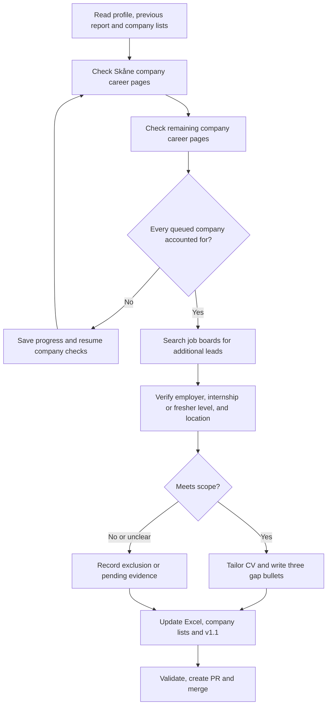

# Internship and fresher search workflow

Updated 2026-11-22. This is the operating workflow for future scans. The 22 November company update is a directory expansion and career-route check, not a new completed 100-job scan.

1. **Load the baseline.** Read requirement.md, profile.md, memory.md, v1.0 originals, v1.1 working documents, the last report and saved application statuses.
2. **Prepare the company queue.** Read companies/registry.csv. Start with company_list_skane.txt, then the remaining company_list.txt entries without duplicates. Resume unfinished checks before repeating completed entries. Resolve missing URLs on official company websites; targeted search to find those sites is allowed before job boards.
3. **Visit company career pages first.** Follow the employer's own ATS and internship/graduate pages. Check UX, UI/UX, interaction and digital product design; use intern, internship, praktik, LIA, graduate, nyexaminerad and entry-level terms. Inspect relevant listings, location filters and pagination. A company landing page alone does not establish complete vacancy coverage.
4. **Log every company outcome.** Record company, career URL, date, pages/filters reviewed, result and any next action. Distinguish complete review, no suitable role, blocked, missing URL and partial review. If interrupted, save the remaining queue and continue it before job boards. Never turn an inaccessible page into “no vacancies.”
5. **Use job websites second.** Only after the company queue is accounted for, search UX Jobs and the listed Swedish job boards for additional leads. Open the employer's listing for every promising lead. Add newly discovered companies after verifying identity, career URL and location. Keep a recruitment agency separate from its named client.
6. **Apply the strict filter.** Accept internships or fresher roles that allow no professional UX experience. Exclude experienced junior, mid-level, senior, lead and manager roles. Unclear requirements stay pending. Onsite/hybrid must be in Skåne; elsewhere must explicitly allow fully remote work from Sweden. Check student eligibility, language, dates, pay and work-location restrictions.
7. **Review and rank.** Deduplicate by employer and vacancy ID/canonical URL. Aim for up to 100 newest in-scope roles, preserve date provenance, and report the actual count. Do not pad the report with experienced roles, expired listings, unrelated jobs or talent pools. Rank confirmed/conditional matches by evidence, not keyword counts alone.
8. **Tailor the documents.** For each shortlisted role, update truthful CV wording in docs/v1.1 and write exactly three main knowledge/evidence-gap bullets. Preserve docs/v1.0. Missing evidence is not proof of missing ability.
9. **Publish clean results.** Update the filterable Excel, CSV/JSON, company registry, names-only lists and lessons. Preserve application status. Save each run's company-check log and any remaining queue beside its report.
10. **Validate and merge.** Check counts, duplicates, eligibility labels, sources, links, three-bullet summaries and original hashes. Open a PR, name it and its report folder PR_<number>_YYYY-MM-DD, then merge validated work under the user's standing authorization. Report failures honestly. Never submit applications or contact employers.

The company directory is a monitoring list, not a list of employers currently hiring interns. “Skåne” means evidenced local office/workplace, not merely Sweden, the Öresund region, Copenhagen or remote access from Skåne. Keep expanding the verified subset each run. The weekly schedule remains Friday 09:00 Europe/Stockholm.
